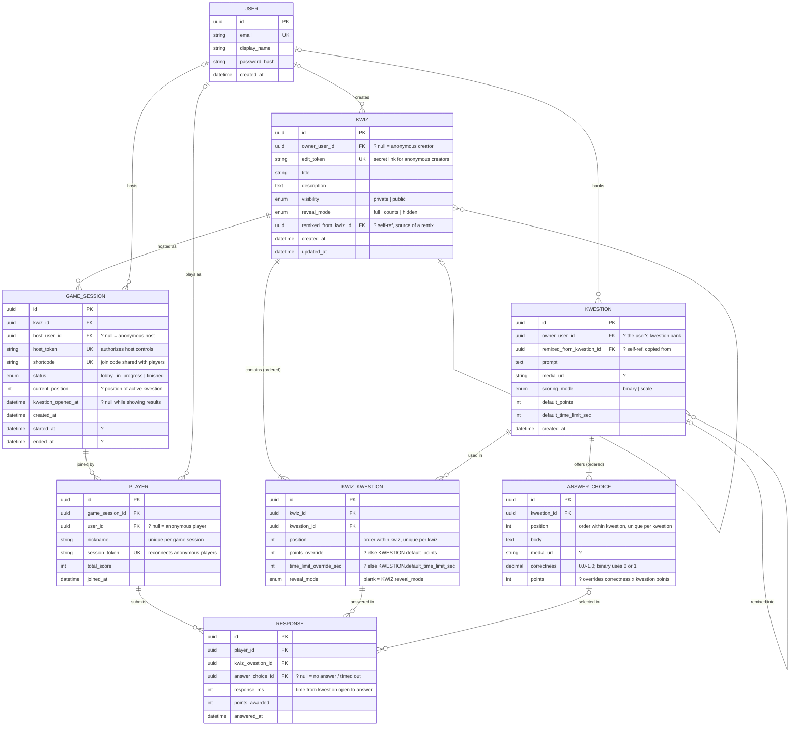

# Kahduke Data Models

Entity-relationship sketch for the kahoot clone. A `?` in an attribute comment means the column is nullable.

## Notes

- **Kwestion bank / reuse.** Kwestions are standalone rows owned by a user. `KWIZ_KWESTION` is the ordered join, so one kwestion can appear in many kwizzes. Points and time limits live on the kwestion as defaults, and each kwiz can override them per slot.
- **Ordering.** `KWIZ_KWESTION.position` is unique per `kwiz_id`, and `ANSWER_CHOICE.position` is unique per `kwestion_id`.
- **"1+" cardinality.** The `||--|{` edges mark the at-least-one rule. The database can't enforce it on its own, so the app checks it before a kwiz can be published or hosted.
- **Correctness.** `correctness` is a decimal in [0, 1]. In `binary` mode choices are 0 or 1. In `scale` mode partial credit is allowed (e.g. 0.5). By default a choice earns `correctness × kwestion points`, scaled by speed. A non-null `ANSWER_CHOICE.points` replaces that.
- **Reveal mode.** After a kwestion closes, `full` shows which choices were right and how many players picked each. `counts` shows only how many picked each, and `hidden` shows nothing. A kwiz sets the default and each slot can override it. Only `full` kwestions add to scores, because a change in score would show who got the answer right. The other two still record each player's choice, with `points_awarded = 0`.
- **Public & remix.** Anyone can host a kwiz whose `visibility = public`. Remixing deep-copies the kwiz and its kwestions and choices to the new owner, and sets the `remixed_from_*` pointers for attribution.
- **No account required.** Creators, hosts and players can all be anonymous. Each role has a nullable `user_id` and a secret token: `edit_token`, `host_token` or `session_token`. A user who signs up later can claim their rows by token.
- **Shortcode.** `GAME_SESSION.shortcode` only has to be unique among active sessions, so codes can be reused after a game finishes. It's enforced with a partial unique index on `status != finished`.
- **Game clock.** `kwestion_opened_at` is set when a kwestion opens and cleared when its results show. The server times each answer from it (`RESPONSE.response_ms`) and rejects answers that arrive after the time limit plus a short grace period.
- **Editing played kwizzes.** Removing a kwestion from a kwiz deletes its `KWIZ_KWESTION` slot, and that slot's responses with it. Snapshotting (below) would preserve them.
- **Possible extensions (not modeled):**
  - Multi-select answers would need a `RESPONSE_CHOICE` join table.
  - Snapshotting the kwiz at game start would protect a running game from mid-game edits.
  - Tags or folders could organize the kwestion bank.
